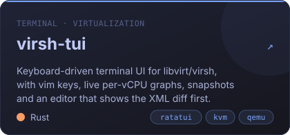
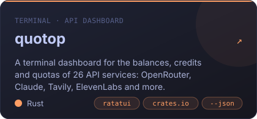
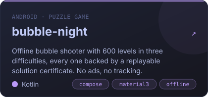
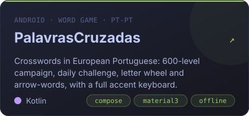
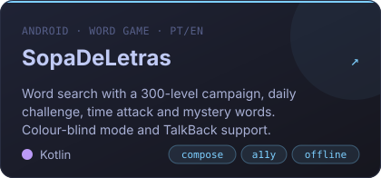
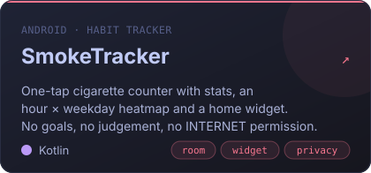

  
  
  
  

## 👋 Hi, I'm Tiago

I build software I want to use myself, and I make sure it treats the people using it with respect.

- 🦀 **In the terminal**, I write keyboard-driven TUIs in **Rust** with [ratatui](https://ratatui.rs): a full manager for KVM/libvirt virtual machines and a dashboard for API quotas.
- 📱 **On Android**, I make **Kotlin + Jetpack Compose** apps and games that run fully offline, with no ads, no accounts and no tracking.
- 🐧 **Day to day**, I live on Linux and care about virtualization, tooling and small, fast binaries.
- 🇵🇹 Some of my games are made first for **European Portuguese**, a language most word games ignore.

## 🚀 Featured projects

<table>
  <tr>
    <td width="50%"></td>
    <td width="50%"></td>
  </tr>
  <tr>
    <td width="50%"></td>
    <td width="50%"></td>
  </tr>
  <tr>
    <td width="50%"></td>
    <td width="50%"></td>
  </tr>
</table>

Also: <a href="https://github.com/SyscallBrain/todo-ratatui"><b>todo-ratatui</b></a>, a to-do manager TUI with categories, priorities, search and a trash bin that survives <code>kill -9</code>.

<b>📸 Screenshots</b>

 

**virsh-tui**: domains dashboard

**quotop**: balances and quotas at a glance

**Android apps**: Bubble Night, Palavras Cruzadas and Sopa de Letras

  
  

## 🧭 What my projects have in common

| Principle | In practice |
|---|---|
| 🔒 **Private by default** | Offline-first, with no ads, no accounts and no analytics. SmokeTracker doesn't even ask for the `INTERNET` permission. |
| ⌨️ **Keyboard first** | Vim keys, discoverable shortcuts, and every destructive action shown before it runs. |
| 🧪 **Proven, not hoped** | CI on every repo. Bubble Night ships 1,800 machine-checked solution certificates, so every level is known to be solvable. |
| 📖 **Documented** | Real screenshots, install guides, changelogs and an [mdBook site](https://syscallbrain.github.io/virsh-tui/) for virsh-tui. |
| 🆓 **Open** | MIT licensed. Fork it, read it, learn from it. |

## 🛠️ Toolbox

<table>
  <tr>
    <td><b>Languages</b></td>
    <td>
      
      
      
      
    </td>
  </tr>
  <tr>
    <td><b>Terminal</b></td>
    <td>
      
      
      
    </td>
  </tr>
  <tr>
    <td><b>Android</b></td>
    <td>
      
      
      
      
    </td>
  </tr>
  <tr>
    <td><b>Systems</b></td>
    <td>
      
      
      
      
      
    </td>
  </tr>
  <tr>
    <td><b>Shipping</b></td>
    <td>
      
      
      
      
    </td>
  </tr>
</table>

## 🐍 Contributions

<picture>
  <source media="(prefers-color-scheme: dark)" srcset="https://raw.githubusercontent.com/SyscallBrain/SyscallBrain/output/snake-dark.svg">
  <source media="(prefers-color-scheme: light)" srcset="https://raw.githubusercontent.com/SyscallBrain/SyscallBrain/output/snake-light.svg">
  
</picture>

---

  <code>exit_group(0)</code>: thanks for stopping by. ⭐ a repo if it's useful to you.

