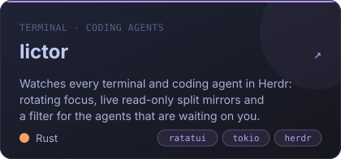
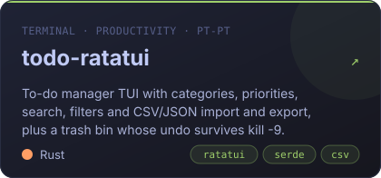
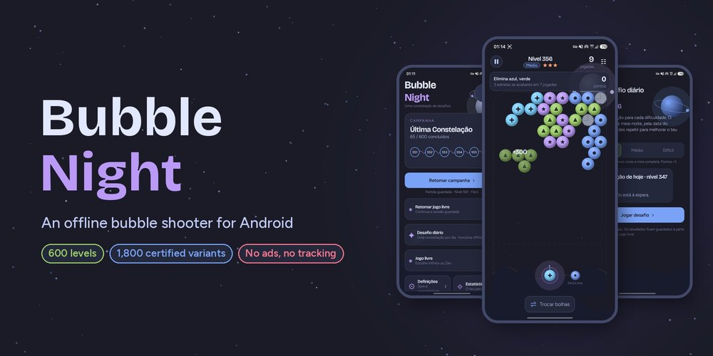
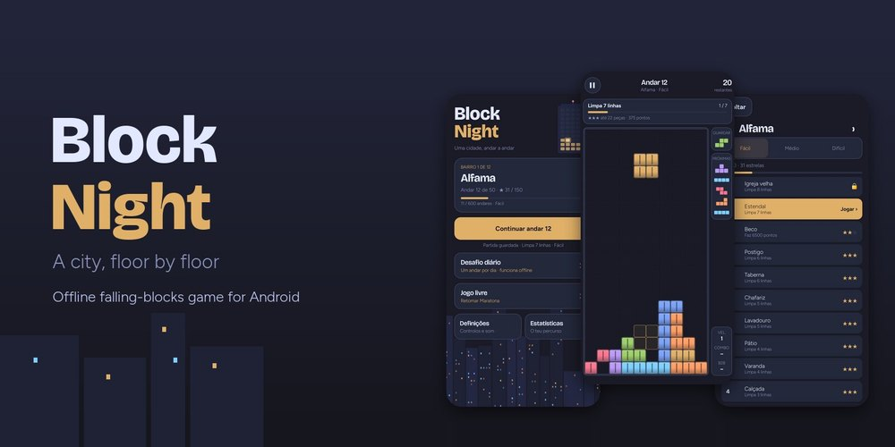
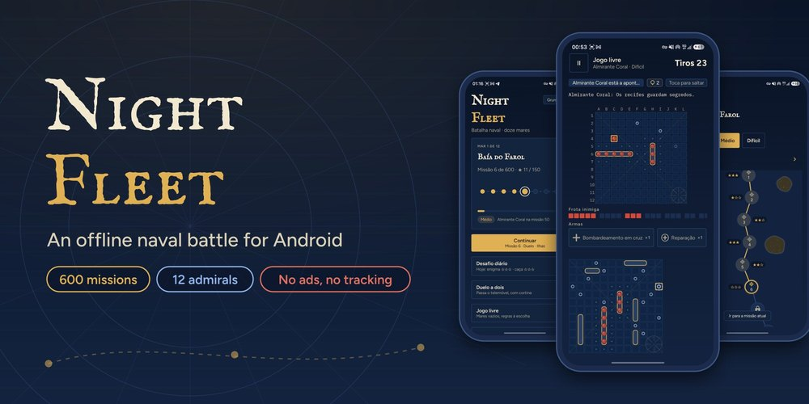
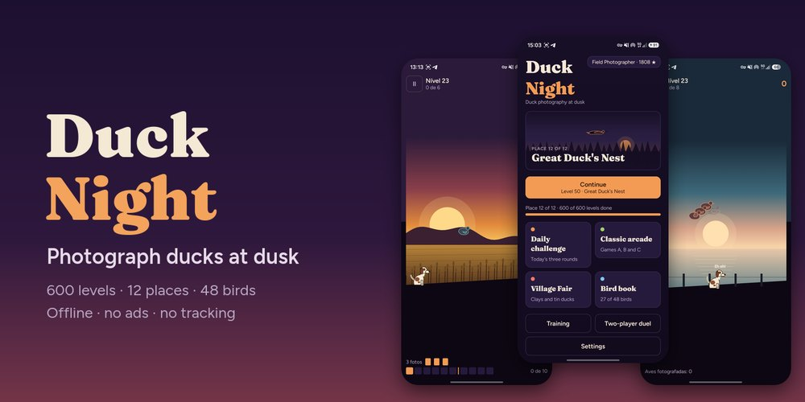
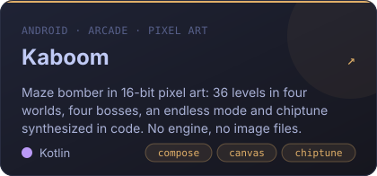

  
  
  
  

## 👋 Hi, I'm Tiago

I build software I want to use myself, and I hold it to the standard I expect as a user: private, fast, documented, and proven to work.

- 🦀 **In the terminal**, I write keyboard-driven tools in **Rust** with [ratatui](https://ratatui.rs): a full manager for KVM/libvirt virtual machines, a dashboard for API quotas and a watcher for coding agents running in parallel.
- 📱 **On Android**, I make **Kotlin + Jetpack Compose** apps and games that run fully offline, with no ads, no accounts and no tracking.
- 🧪 **I prefer proof to promises**: my games run on deterministic engines, and every level of the Night series ships with a machine-checked solution certificate.
- 🐧 **Day to day**, I live on Linux and care about virtualization, tooling and small, fast binaries.
- 🇵🇹 Some of my games are made first for **European Portuguese**, a language most word games ignore.

## 🦀 Terminal tools

Keyboard-driven Rust tools built on [ratatui](https://ratatui.rs), each shipped as a single fast binary.

<table>
  <tr>
    <td width="50%"></td>
    <td width="50%"></td>
  </tr>
  <tr>
    <td width="50%"></td>
    <td width="50%"></td>
  </tr>
</table>

## 🌙 The Night series

Four offline Android games built on one foundation: a deterministic Kotlin engine shared by the game and its offline solver, 600 levels in three separately tuned difficulties, and a **solution certificate for every one of the 1,800 variants**. CI replays all of them, so an impossible level can never ship. The only permission they ask for is `VIBRATE`.

<table>
  <tr>
    <td width="50%" valign="top">
      
       <b><a href="https://github.com/SyscallBrain/bubble-night">Bubble Night</a></b> · bubble shooter
       600 constellations across 12 orbits
    </td>
    <td width="50%" valign="top">
      
       <b><a href="https://github.com/SyscallBrain/block-night">Block Night</a></b> · falling blocks
       600 floors across 12 Lisbon districts
    </td>
  </tr>
  <tr>
    <td width="50%" valign="top">
      
       <b><a href="https://github.com/SyscallBrain/night-fleet">Night Fleet</a></b> · naval battle
       600 missions against 12 admirals who never cheat
    </td>
    <td width="50%" valign="top">
      
       <b><a href="https://github.com/SyscallBrain/duck-night">Duck Night</a></b> · reflex game
       Photograph ducks at dusk: 600 levels, 48 birds
    </td>
  </tr>
</table>

## 📱 More for Android

Word games written for European Portuguese, a pixel-art arcade game, and a habit tracker that keeps your data on your phone.

<table>
  <tr>
    <td width="50%"></td>
    <td width="50%"></td>
  </tr>
  <tr>
    <td width="50%"></td>
    <td width="50%"></td>
  </tr>
</table>

<b>📸 Screenshots</b>

 

**virsh-tui**: domains dashboard

**quotop**: balances and quotas at a glance

**lictor**: a live, read-only mirror of two rotating lanes in Herdr

**Kaboom**: the four worlds, every sprite drawn in code

**Palavras Cruzadas** and **Sopa de Letras**

  
  

## 🧭 How I build

| Principle | In practice |
|---|---|
| 🔒 **Private by default** | None of my eight Android apps asks for the `INTERNET` permission, so they *can't* phone home: no ads, no accounts, no analytics. Your data stays on the device, with export and import when you want it. |
| 🧪 **Proven, not hoped** | The Night games ship 7,200 solution certificates that CI replays with the real engine; if a level becomes impossible, the build fails. Night Fleet and Duck Night also rebuild every release from two fresh clones and compare the APKs byte for byte. |
| ⌨️ **Keyboard first** | Vim keys, discoverable shortcuts and which-key hints. virsh-tui shows the exact `virsh` command before it runs, and Lictor only ever observes your agents, never types into them. |
| ♿ **Accessible** | Colour-blind palettes, TalkBack descriptions, left-handed layouts and reduced motion, built into most of my games. |
| 📖 **Documented** | Real screenshots, install guides, changelogs, READMEs in English and Portuguese, and mdBook sites for [virsh-tui](https://syscallbrain.github.io/virsh-tui/) and [Lictor](https://syscallbrain.github.io/lictor/). |
| 🆓 **Open** | MIT licensed. Fork it, read it, learn from it. |

## 🛠️ Toolbox

<table>
  <tr>
    <td><b>Languages</b></td>
    <td>
      
      
      
      
    </td>
  </tr>
  <tr>
    <td><b>Terminal</b></td>
    <td>
      
      
      
    </td>
  </tr>
  <tr>
    <td><b>Android</b></td>
    <td>
      
      
      
      
    </td>
  </tr>
  <tr>
    <td><b>Systems</b></td>
    <td>
      
      
      
      
      
    </td>
  </tr>
  <tr>
    <td><b>Shipping</b></td>
    <td>
      
      
      
      
    </td>
  </tr>
</table>

## 🐍 Contributions

<picture>
  <source media="(prefers-color-scheme: dark)" srcset="https://raw.githubusercontent.com/SyscallBrain/SyscallBrain/output/snake-dark.svg">
  <source media="(prefers-color-scheme: light)" srcset="https://raw.githubusercontent.com/SyscallBrain/SyscallBrain/output/snake-light.svg">
  
</picture>

---

  <code>exit_group(0)</code>: thanks for stopping by. ⭐ a repo if it's useful to you.

